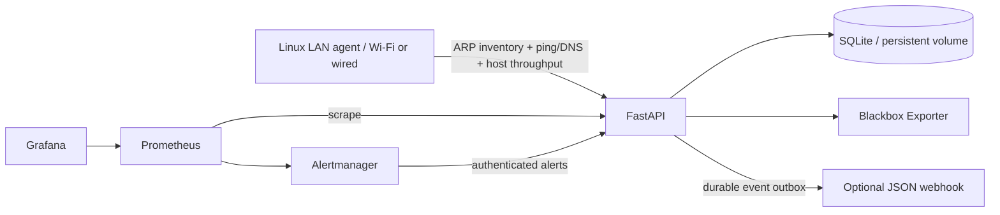

# Lanmark

A containerized home-network monitor combining device discovery, connection history,
reliability measurements, and statistical incident detection. The application lives
here; deployment settings live in the sibling `lanmark-config` Git repository.
The shared `cluster-config` repository registers the application with Argo CD.



## What it measures

- IPv4 LAN devices responding to ARP, identified by MAC, with IP changes,
  first/last seen timestamps, approval state, and per-agent online/offline events.
- Gateway and multiple public IP reachability, packet loss, latency, RTT variation,
  DNS query time, HTTP connectivity, and one-hour availability.
- Latency anomalies using median/MAD baselines, connectivity incidents, new-device
  incidents, host interface traffic spikes, recoveries, and recurring outage history.
- Agent heartbeat and discovery freshness, missing probe telemetry, and notifications.

This is an original small monitoring service inspired by NetAlertX, not a NetAlertX
deployment. It does not enumerate AP associations: wired devices also appear, sleeping
or isolated clients may be absent, randomized MACs can look like new devices, and
IPv6-only clients are outside the ARP inventory. Device approval is an inventory
decision; it does not block a device on the router.

The agent must run on a **native Linux LAN host** (a Raspberry Pi or Linux computer
works). Connect that host to Wi-Fi for a Wi-Fi-path measurement. A pod in this k3d
cluster sees the Docker network, and Docker Desktop host mode supports TCP/UDP at
layer 4 rather than ARP access to the physical LAN. Cluster probes are still useful
as a second viewpoint. Comparing Wi-Fi and wired agents helps distinguish the
wireless link from router or ISP problems; these probes alone cannot prove a cause.
See [Docker's host-network limits](https://docs.docker.com/engine/network/drivers/host/)
and [Scapy's ARP discovery documentation](https://scapy.readthedocs.io/en/latest/usage.html#arp-ping).

Throughput comes from the Linux agent's interface byte counters. It measures that
host's traffic, **not total LAN traffic or individual devices' bandwidth**. Collecting
network-wide usage requires router telemetry (for example SNMP/flow exports) or a
mirror port, which is a future integration.

## Start locally with Docker Compose

Keep `lanmark` and `lanmark-config` beside each other. Docker Compose reads
the same monitoring configuration and Grafana dashboard used by Kubernetes.

1. Copy `.env.example` to `.env`. Set distinct random API and agent tokens of at
   least 32 characters and a Grafana admin password. For example, generate each
   token separately with `openssl rand -hex 32`. Keep `.env` outside Git.
2. Edit `../lanmark-config/base/config/lanmark.yaml` for your router and DNS
   addresses. Set `expected_agents` to the IDs you will actually run; use `[]` if
   initially running only cluster/container probes.
3. Run:

```bash
docker compose up -d --build
docker compose ps
```

Open `http://localhost:3000` and sign in as `admin` with the configured password.
The provisioned dashboard is **Lanmark - Devices and Reliability**. The API and
interactive API docs are at `http://localhost:8000` and `/docs`. In Swagger UI use
**Authorize** with the admin token. The API and Grafana ports bind to loopback.
Prometheus, Blackbox Exporter, and Alertmanager have no published host ports.

`docker compose down` retains data volumes. `down -v` destroys them. LAN agents need
a reachable API endpoint; use the Kubernetes ingress or a secured reverse proxy for
Compose. Localhost on another machine points to that other machine.

## Run the discovery agent

On the native Linux host, copy `agent.example.yaml` to `agent.yaml`, then configure
its LAN interface, subnet, router/DNS targets, and source ID. Use `ip -br addr` to
identify the interface. Private IPv4 subnets of /22 or smaller are supported.
Use distinct source IDs for multiple hosts (for example `home-wifi` and `home-wired`)
and add each to `expected_agents` in the server configuration.

```bash
export LANMARK_API_URL='http://lanmark.home.arpa:8080'
export LANMARK_AGENT_TOKEN='<same ingestion token configured on the API>'
docker compose -f compose.agent.yaml up -d --build
docker compose -f compose.agent.yaml logs -f
```

The agent uses host networking and only `NET_RAW`, not privileged mode. It scans
the configured subnet with ARP every 30 seconds and sends five-packet ping bursts
and DNS queries to the configured targets. It retries each batch three times using
the same scan ID; the API applies a batch atomically once. After repeated delivery
failure it drops that cycle and collects a fresh one. There is no offline agent
queue, so a disconnected agent leaves a measurement gap rather than replaying old
presence data as current. The first interface traffic rate appears after two cycles.

The sample URL uses trusted-LAN HTTP to match the current cluster. API tokens are
bearer credentials: use HTTPS at the ingress or a trusted VPN before crossing an
untrusted network. No credentials are committed in any repository.

## API examples

```bash
export LANMARK_URL='http://localhost:8000'
export LANMARK_API_TOKEN='<admin token>'
curl -H "Authorization: Bearer $LANMARK_API_TOKEN" "$LANMARK_URL/v1/devices"
curl -X PUT -H "Authorization: Bearer $LANMARK_API_TOKEN" \
  -H 'Content-Type: application/json' \
  -d '{"approved":true,"name":"Living room TV"}' \
  "$LANMARK_URL/v1/devices/aa:bb:cc:dd:ee:02/approval"
curl -H "Authorization: Bearer $LANMARK_API_TOKEN" \
  "$LANMARK_URL/v1/devices/aa:bb:cc:dd:ee:02/history"
curl -H "Authorization: Bearer $LANMARK_API_TOKEN" \
  "$LANMARK_URL/v1/incidents?active_only=true"
curl -H "Authorization: Bearer $LANMARK_API_TOKEN" "$LANMARK_URL/v1/agents"
curl -H "Authorization: Bearer $LANMARK_API_TOKEN" \
  "$LANMARK_URL/v1/samples?source=home-wifi&target=router"
```

Read endpoints support `limit` and `offset`. History and sample rows use Unix UTC
timestamps. The ingestion token can only call `POST /v1/scans`; source IDs must
be allowlisted. Administrative reads, approvals, `/metrics`, and Alertmanager's
`POST /v1/alerts` require the admin token. `/healthz` and the API schema are public.
Run one API process and one replica: SQLite and the collection scheduler are
designed for a single service instance.

## Incidents and notifications

Latency detection requires **30 previous successful samples** per source/target
and uses up to the latest 120 observations. The trigger is the baseline median
plus the largest of six scaled MADs, 20ms, or twice the median. This one-sided rule
avoids zero-variance false positives and excludes the current sample from training.
Traffic detection uses the same robust rule with a 1 MB/s floor. No scikit-learn
model or LLM is needed for this initial statistical implementation.

Each source's same-cycle gateway, public IP, DNS, and HTTP results produce a
deterministic explanation of likely causes, including uncertainty about filtering.
Active incidents update rather than opening another notification every scan.
Recovery resolves them; a later failure opens a new record, preserving recurring
outage history. `occurrences` counts failing observations in the incident, not
distinct outages. An optional LLM can later summarize the stored evidence, but
there is currently no LLM integration and no data is sent to an AI provider.

Six or more observed appearances of one device on one agent within an hour also
open a device-activity incident; it resolves after an hour without another trigger.
This may indicate unstable connectivity, sleep cycles, or intermittent ARP replies
and is not a claim that the device is malicious.

Set `NOTIFICATION_WEBHOOK_URL` to a receiver accepting generic JSON. Open/resolved
incident events are queued in SQLite and retried with backoff up to one hour until
an HTTP 2xx response. Delivery is at least once, so receivers should tolerate
duplicates. With no webhook, events stay pending; configuring one later drains the
backlog. This generic payload is not a Slack/Discord-specific payload. Alertmanager
groups Prometheus alerts and sends them into the API's incident pipeline. Add a
direct Alertmanager receiver for paging when the API itself is down.

Failed ARP scans preserve presence; devices are marked offline only after a
successful scan observes their absence beyond the 180-second grace period.
Missing-agent and stale-discovery alerts indicate when inventory cannot be trusted.
Cluster packet loss is the failure fraction across up to 20 samples; cluster jitter
is the absolute difference between consecutive successful RTTs. Agent packet loss
and jitter use each five-packet burst (jitter is the mean consecutive RTT difference).
DNS duration measures the configured DNS query; HTTP duration covers the full probe.
Grafana availability averages observed scrape values and is not an outage SLA;
always inspect sample freshness alongside it.

Samples, connection events, scan IDs, resolved incidents, and delivered notifications
expire after 30 days. Device approvals and inventory, active incidents, and pending
notifications persist. SQLite reuses freed pages; pruning does not shrink the volume
file immediately. Prometheus has separate 30-day / 8GB retention limits.

## Publish and deploy

```bash
docker build --target api -t angelobellizzi/lanmark:0.1.0 .
docker build --target agent -t angelobellizzi/lanmark-agent:0.1.0 .
docker push angelobellizzi/lanmark:0.1.0
docker push angelobellizzi/lanmark-agent:0.1.0
```

Use a new immutable version for subsequent builds. Update the API image tag in
`../lanmark-config/overlays/lan/kustomization.yaml` and the agent tag in
`compose.agent.yaml`. Publish the two new Git repositories to your own remotes;
the Argo registration assumes `https://github.com/abellizzi1/lanmark-config.git`.
Full cluster setup and secret commands are in `../cluster-config/README.md`.
The `lanmark-config` README covers deployment configuration and backups.

Docker installs the runtime versions recorded in `requirements-api.lock` and
`requirements-agent.lock`. When upgrading dependencies, refresh those snapshots
from a reviewed Python 3.12 build and validate the images again.
